<p align="center"></p>

<p align="center">
  <a href="https://sgm-group-of-companies.vercel.app"></a>
  
  
</p>

## What it is

A company site and a **mobile-first parts marketplace** for **SGM Group** in Monrovia, Liberia. Customers browse engine oils, spare parts, tyres, batteries, fluids and accessories, see prices in **Liberian dollars and US dollars**, and check out from a phone. It installs like an app.

**In plain English:** a drivers' shop in your pocket. Find the part, see the price in your currency, add it to the cart.

## What it does

| Route | What it is |
|---|---|
| `/`, `/about`, `/contact` | The company website |
| `/marketplace` | The marketplace entry |
| `/app` | The installable shop: products, product detail, cart, checkout and orders |

- **Products** carry a brand, category, stock state, rating and review count, flash-deal and new flags, and **variants with their own LRD and USD prices**.
- **Six categories:** engine oils, spare parts, tyres, batteries, fluids and accessories.
- **Mobile layout** with a bottom navigation bar, and a desktop sidebar on larger screens.
- **Installable.** `public/manifest.json` makes it a standalone app that starts at `/app`, and `next-pwa` handles the service worker.

## Stack

Next.js 14 (App Router), React 18, Zustand for the cart, Framer Motion, Tailwind, `next-pwa` and lucide-react.

## Run it

```bash
npm install
npm run dev     # http://localhost:3000
```

<p align="center"></p>

<p align="center"><sub>Built by <a href="https://github.com/sameermotwani17-cell">Sameer Motwani</a> · <a href="https://portfolio-sameermotwani17-cells-projects.vercel.app">portfolio</a></sub></p>
